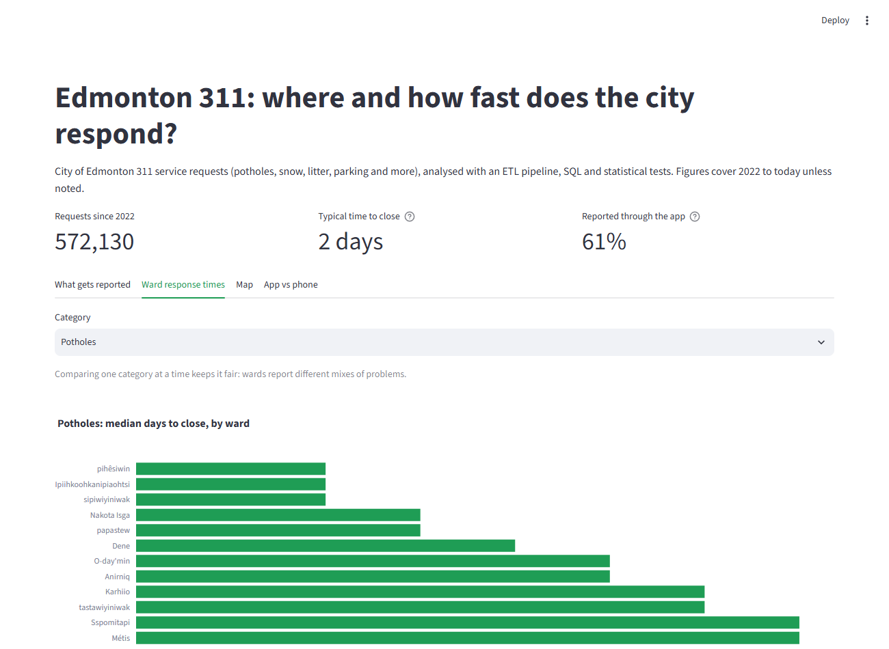
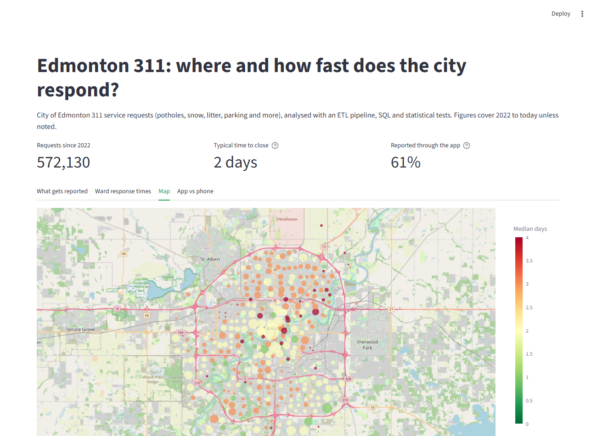

# Edmonton 311 Service Requests: Where and How Fast Does the City Respond?

**An end-to-end analysis of 1.25 million City of Edmonton 311 requests (2013 to present): an ETL pipeline from
the City's open data API into DuckDB, SQL analysis, rank-based statistical tests, and an interactive dashboard.**

**[▶ Open the live dashboard](https://edmonton-311.streamlit.app/)**



## Key findings

1. **Parking complaints are a quarter of all requests.** Since 2022: parking complaints 25.4%, snow and ice
   14.6%, encampments 9.0%, potholes 8.6%, litter 7.8%.
2. **Potholes peak in March, not "spring" in general.** In a typical year (2022-2025), March has 1,769
   pothole requests against 83 in December, 21 times more. That's the freeze-thaw cycle. January is the busiest month
   overall (11,761 requests), driven by snow and ice.
3. **Most requests are closed within days, but averages mislead.** The median closed request takes 2 days.
   Street signs have a median of 3 days but a mean of 29: a slow tail (90th percentile 79 days) drags the
   average up ten times.
4. **Duplicate reports hide real response times.** About 100,000 closed requests since 2022 were duplicates,
   which close almost instantly. Excluding them doubles the typical encampment response time (2 to 5 days)
   and potholes go from 2 to 4 days.
5. **Wards differ, but only a little.** For potholes, the median ranges from 2 days (pihêsiwin) to 7 days
   (Métis). The difference is real (Kruskal-Wallis p < 0.001) but small: ward explains about 3% of the
   variation in response time. A pothole report in pihêsiwin is closed before one in Métis 67% of the time.
6. **The app helps for potholes, not everywhere.** Pothole reports made through the app close in a median of
   4 days against 7 by phone (90th percentile: 53 vs 85 days). Litter and snow show little difference. A
   likely reason, which the data can't prove, is that app reports include a photo and exact location.
7. **The app is now the main channel:** 61% of closed requests since 2022 (duplicates excluded) came through the mobile app.

## Methods

### 1. Extract ([`src/extract.py`](src/extract.py))
Downloads the 311 Explorer dataset from the City's Socrata API in pages of 50,000 rows (`$limit` / `$offset`,
ordered by `:id` so pages never overlap), with retries on failed requests. Result: 1,250,303 rows in 26 pages.

### 2. Transform ([`src/transform.py`](src/transform.py))
- Renamed confusing API columns (`display_name` -> `neighbourhood`, `neighborhood_district` -> `ward`).
- Converted types, checking that no value was silently lost (missing counts identical before and after).
- Calculated `days_to_close`; added year, month, season and ward system (old numbered vs new named wards).
- **Merged renamed categories** ("Pothole" -> "Potholes", "Snow & Ice Maintenance" -> "Maintenance - Snow & Ice",
  and others), found by checking which years each name was used. Categories the City *split* into several new
  ones around 2020-2021 were deliberately **not** merged, because that would mean guessing which new category
  each old request belonged to.
- **Flagged problem rows instead of deleting them:** 2 impossible coordinates (e.g. longitude 30741.0),
  37 tickets marked closed with no close date, and partial years (2013 and the current year).
- Saved to Parquet: 555 MB of raw JSON became a 34 MB file.

### 3. Load ([`src/load.py`](src/load.py))
Loads the clean table into a DuckDB database file. DuckDB is a file-based analytical database. The SQL is
standard and portable to PostgreSQL (one difference is noted in the queries: forcing decimal division).

### 4. SQL analysis ([`sql/`](sql/))

| Query | Question | Techniques |
|---|---|---|
| [01](sql/01_top_categories.sql) | What do Edmontonians report most? | GROUP BY, window function for % of total |
| [02](sql/02_seasonal_patterns.sql) | How do requests change through the year? | Conditional aggregation (`FILTER`), pivot |
| [03](sql/03_response_times.sql) | How fast is each category closed? | Median, percentiles, `HAVING`, NULL-safe filtering |
| [04](sql/04_ward_response_times.sql) | Are some wards served faster? | CTEs, `RANK()` window function |
| [05](sql/05_source_response_times.sql) | Is the app faster than phoning? | `CASE` grouping, two-column `GROUP BY` |

Results are in [`results/`](results/). Run any query with `python -m src.run_sql sql/<file>.sql`.

**Comparing like with like.** Wards report very different mixes of problems: Sspomitapi's requests are
40.6% parking complaints (fast to close), while O-day'min's are 17.2% parking and 14.9% encampments (slow).
Comparing all requests together, Sspomitapi looks like one of the fastest wards. Comparing potholes only, it
ranks 11th of 12. So ward and channel comparisons are done **within a single category**, to control for this
confounder.

### 5. Statistical test ([`src/stats_test.py`](src/stats_test.py))

**Why Kruskal-Wallis and Mann-Whitney U, not ANOVA or a t-test?**

Response times are **heavily skewed**: most pothole tickets close in a few days, but some take months or
years (the 90th percentile is 35 to 77 days depending on the ward, and the longest request took over 11
years). The common tests, one-way ANOVA and the t-test, compare **averages** and assume the data roughly
follows a bell curve. Neither holds here, because a few extreme tickets pull the averages far above the
typical experience.

Both tests used here are **rank-based (non-parametric)**: they line up every ticket from fastest to slowest
and compare the groups' **positions** in that line, not the raw number of days. A 4,000-day ticket simply
counts as "the slowest", so it can't distort the result.

- **Kruskal-Wallis** is the rank-based alternative to one-way ANOVA. It compares **more than two groups at
  once** (all 12 wards) and asks whether there is a difference anywhere among them. Testing all 66 pairs of
  wards separately instead would inflate the chance of a false alarm.
- **Mann-Whitney U** is the rank-based alternative to the two-sample t-test. It compares **exactly two
  groups**, used here for the fastest vs the slowest ward. Its statistic converts directly into an
  easy-to-explain effect size: the probability that a random ticket from one ward is closed before a random
  ticket from the other.

**Why effect sizes matter more than p-values here:** with 33,133 pothole tickets, almost any difference is
"statistically significant". So each result reports how big the difference is, as well as whether it is real:

| Measure | Result | Meaning |
|---|---|---|
| Kruskal-Wallis | H = 1,024.4, p = 1.1 × 10⁻²¹² | The ward differences are not chance |
| Epsilon squared (effect size) | 0.031 (small) | Ward explains about 3% of the variation in response time |
| Mann-Whitney U, pihêsiwin vs Métis | p = 4.4 × 10⁻¹¹¹ | The two extremes really differ |
| Probability pihêsiwin closes first | 67% | Noticeable, but far from "always" (50% = no difference) |

**Conclusion:** pothole response times differ between wards and it isn't chance, but the effect is small. The
data shows *that* tickets close faster in some wards, not *why*. Road type, timing of reports and crew
workload could all contribute.

### 6. Dashboard ([`app/dashboard.py`](app/dashboard.py), [live](https://edmonton-311.streamlit.app/))
Streamlit app with four tabs: top categories and seasonal patterns, ward response times for **any**
category (the Kruskal-Wallis and Mann-Whitney tests rerun live, reusing `src/stats_test.py`), a neighbourhood map,
and app vs phone. It reads small pre-computed summaries ([`src/build_dashboard_data.py`](src/build_dashboard_data.py),
about 1 MB in total) instead of the full database, so it loads quickly. The summaries contain no street addresses;
the map shows one point per neighbourhood.



## Limitations
- **"Days to close" is not "days to fix".** Some tickets are closed when work is deferred
  ("Deferred - Future Work Planned" closes in about a day) or when no action is needed.
- **Dates have no time of day**, so response time is measured in whole days.
- **Ward boundaries changed in 2021.** Ward comparisons use 2022 onwards only (the new named wards).
- **Categories were reorganised around 2020-2021.** Long-term trends are only reliable for categories that
  stayed consistent or were cleanly renamed (e.g. potholes, snow and ice, litter).
- **Observational data:** differences between wards or channels show association, not cause.

## Run it yourself

Requires Python 3.12.

```bash
git clone https://github.com/temiloluwadeboye/edmonton-311-analysis.git
cd edmonton-311-analysis
python -m venv .venv
.venv\Scripts\activate          # Windows (macOS/Linux: source .venv/bin/activate)
pip install -r requirements.txt

python -m src.extract           # download ~1.25M rows from the City's API (a few minutes)
python -m src.transform         # clean -> data/processed/requests.parquet
python -m src.load              # -> data/edmonton_311.duckdb
python -m src.run_sql sql/04_ward_response_times.sql
python -m src.stats_test
python -m src.build_dashboard_data
streamlit run app/dashboard.py
python -m pytest                # 9 tests for the cleaning step
```

`build_dashboard_data` also writes `app/data/edmonton_311_summary.csv`, a flat summary for Tableau or Power BI.

## Project structure

```
├── app/          Streamlit dashboard and its small summary data
├── data/         raw pages, clean Parquet file and DuckDB database (not in git; rebuilt by the pipeline)
├── docs/images/  screenshots
├── results/      saved query results and statistical test output
├── sql/          the five analysis queries
└── src/          extract, transform, load, SQL runner, statistical test, dashboard data
```

## Data

**311 Explorer**, City of Edmonton Open Data Portal: https://data.edmonton.ca/Indicators/311-Explorer/ukww-xkmj
(updated daily; coverage January 1, 2013 to present).

The dataset is publicly available from the City of Edmonton under the
[City of Edmonton Open Data Terms of Use (version 2.1)](https://www.edmonton.ca/sites/default/files/public-files/assets/Web-version2.1-OpenDataAgreement.pdf).
Raw data is not stored in this repository; the pipeline downloads it from the City's API. The small aggregated
summaries in `app/data/` are derived from it and are shared under the same terms.

This project is independent and is not affiliated with, sponsored or endorsed by the City of Edmonton.

## License

Code: [MIT](LICENSE). Data: City of Edmonton Open Data Terms of Use, as above.
